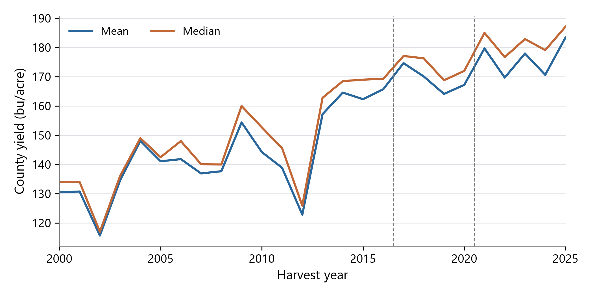
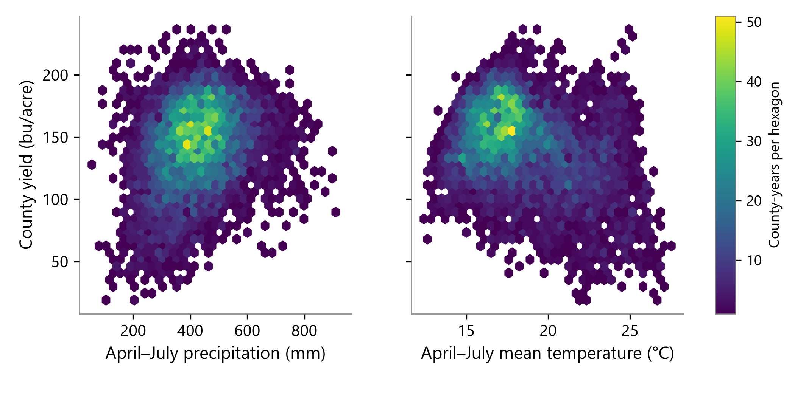
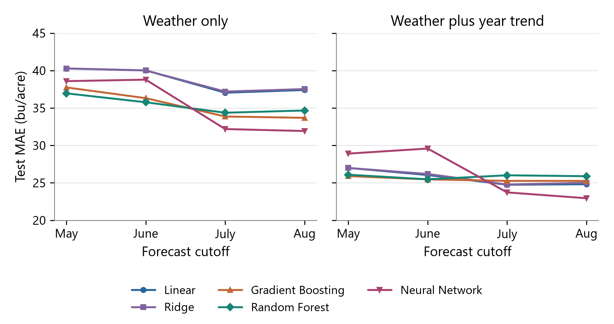
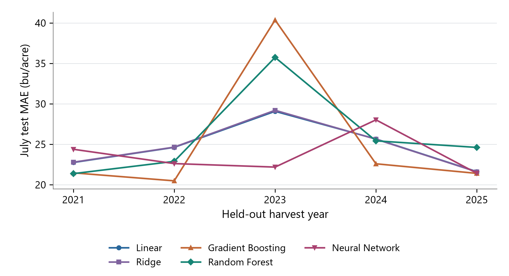
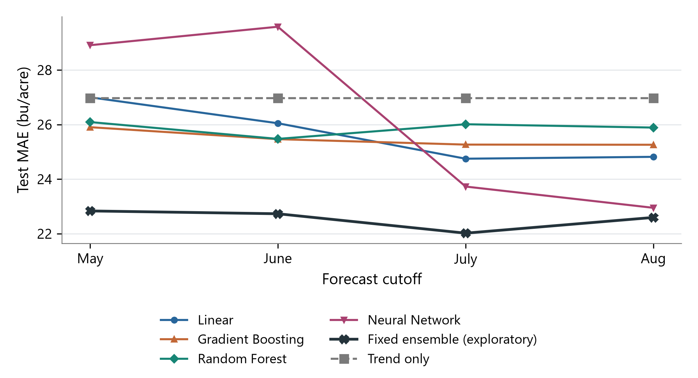

# Evaluating the Reliability of Early-Season Corn Yield Predictions Under Extreme Weather Using Machine Learning

**CS 422 group project · Fall 2026 · Technical report**

**Team: not applicable (Group 2)**

**Russell Kennedy, Tylie Anderson, Alexander Aquiningoc, and Lester Iwuajoku**

## Abstract

We evaluate whether annual county-level U.S. corn-grain yield can be forecast by the end of May, June, July, or August using weather observed through each cutoff. USDA National Agricultural Statistics Service (NASS) county yields are paired with NOAA nClimGrid-Daily county-area weather. The primary comparison uses 393 counties with complete observed yields and January–August weather in every year from 2000 through 2025. Models fit 2000–2016, use 2017–2020 for validation, and are evaluated on the same 1,965 county-years from 2021–2025 at each cutoff. We compare Linear and Ridge regression, Gradient Boosting, Random Forest, and a single-hidden-layer Neural Network under weather-only and weather-plus-year-trend predictor lists. Mean absolute error (MAE, bushels per acre) is primary; root mean squared error (RMSE), bias, yearly errors, and exploratory weather-group errors support interpretation. The training-mean reference has 42.29 test MAE. On the July test, adding the declared year feature reduces Linear MAE from 37.04 to 24.75; a trend-only Linear comparator reaches 26.97. Weather-plus-trend validation favors Gradient Boosting among individual standard models at all four cutoffs, while the held-out test ranking changes by cutoff and year. A later fixed, equal-weight four-family average obtains July test MAE 22.02, but is exploratory because it was added after initial test results were visible. The strong time signal, selective cohort, revised historical weather, omitted farm variables, and only five test years limit claims about future operational forecasts.

**Keywords:** corn yield; early-season forecasting; county-level regression; chronological holdout; weather; model comparison.

## 1. Problem and approved objective

Farmers, agricultural producers, crop insurers, researchers, and public agencies can use early indications of corn production risk for planning. Published USDA corn-production forecasts also influence corn futures prices and their daily variability [1]. The task here is narrower: estimate each county's **annual corn-grain yield, in bushels per acre**, at four preharvest dates. The desired output is a forecast with an honest account of its typical error and of conditions where that error rises. This is a retrospective modeling study, not a live forecast service or a causal estimate of weather effects.

The approved team proposal [4] asked how early useful predictions become possible and whether reliability changes during unusual weather. Our contribution beyond a standard algorithm exercise is to align two public county-level sources, enforce a common chronological test on identical county-years, vary the weather cutoff, and report failure cases rather than only one pooled score. The initial proposal considered past yields, heat exposure, and uncertainty intervals as possible extensions. The shared version-one comparison instead uses the fixed weather recipe below and a separately named year-trend variant; no lagged yield feature or formal prediction interval is claimed. See the [approved project specification](../PROJECT_SPEC.md) and [feature plan](../FEATURE_PLAN.md) for the recorded scope decisions.

## 2. Data and preparation

### 2.1 Sources, unit, and permitted use

The target is a USDA NASS Quick Stats county survey estimate for corn grown for grain [2]. Predictors are temperature and precipitation from NOAA nClimGrid-Daily county-area averages [3]. Both are publicly accessible government data used here for aggregate academic analysis; no farmer-level records or private identifiers enter the model. The unit of prediction is a **county, harvest year, and forecast cutoff**. The same annual yield is the label for May, June, July, and August forecasts for one county-year; those four rows are not four independent harvests.

The processed USDA panel contains 151,310 county-year yield records from 1951–2025 across 2,821 canonical county identities in 41 states. A documented county-name and identifier crosswalk matched 151,288 records (99.99%) to a NOAA location; the 22 unmatched historical Washabaugh, South Dakota records precede this study's 2000–2025 period. The processed January–August monthly panel contains 1,210,480 county-month rows, of which 1,210,304 have a NOAA county match. The [data-quality report](../data/processed/data_quality_report.json) and [preparation script](../scripts/prepare_data.py) record the source counts, validation rules, and input hashes.

### 2.2 Quality checks and cohort definition

The pipeline checks county identifiers, years, finite nonnegative yields, unique county-year targets, weather calendars, and NOAA source-file consistency. Zero yields and zero precipitation are valid observations. NOAA missing-value sentinels are treated as missing rather than numerical extremes; the optional USDA coefficient-of-variation field can be missing without becoming a predictor. No missing yield or weather value is imputed for this comparison. Source identifiers are retained alongside normalized county FIPS for traceability.

The [quality report](../data/processed/data_quality_report.json) records 142,751 missing optional yield-CV values among 151,310 yield records and retains 499 zero-yield observations. Across 2,400 NOAA source files it reports no missing valid calendar days; padding sentinels are excluded, and 176 county-month rows lack a crosswalk match. The primary cohort's complete-data rule removes incomplete county histories rather than filling their gaps, which is a source of selection bias.

The **primary complete-county cohort** retains 393 counties with an observed target and complete January–August precipitation and temperature data in every year from 2000–2025: 10,218 county-years. This rule yields identical county coverage in all partitions and cutoffs, but it selects counties with unusually continuous reporting and must not be interpreted as a representative U.S. county sample. The [study-data plan](../STUDY_DATA_PLAN.md) also defines nested 90%, 80%, and largest-available coverage sets. Those broader populations answer a different coverage question; their raw error scores are not automatically comparable to the primary cohort's scores.

**Table 1. Fixed primary-cohort split.** Counts are county-years per cutoff; each of the four cutoffs inherits the same harvest-year assignment.

| Partition | Harvest years | Years | County-years | Share of 10,218 | Use |
|---|---|---:|---:|---:|---|
| Training | 2000–2016 | 17 | 6,681 | 65.38% | Fit models and learned preprocessing |
| Validation | 2017–2020 | 4 | 1,572 | 15.38% | Select settings and compare candidates |
| Final test | 2021–2025 | 5 | 1,965 | 19.23% | Evaluate frozen choices |

### 2.3 Forecast-time features

At the end of each cutoff month, a model sees January–March preseason precipitation, mean temperature, and coldest-day summary; six individual monthly weather summaries from April through the cutoff; and six season-to-date summaries over that same April-to-cutoff window. This gives 21, 27, 33, and 39 weather predictors in May through August, respectively. The secondary **weather-plus-trend** list adds exactly one forecast-time-known value, `year_since_2000 = harvest_year − 2000`. The corresponding **weather-only** list has no year predictor. The trend is a broad time proxy, not a county-specific fitted yield history or proof of a particular cause. County FIPS, raw year, partition, cutoff metadata, and target are not inferred as predictors. The generated feature manifest and the tracked [feature plan](../FEATURE_PLAN.md) and [feature configuration](../config/features.json) define the exact allowlists.

No weather later than a cutoff enters its feature calculation. However, NOAA's historical fields can be revised after initial release [3]. These retrospective values establish a cutoff-safe *calendar window*, not a fully faithful archive of what a user could have downloaded on each original forecast date.

### 2.4 Exploratory data analysis

The fixed-cohort yield distribution shifts across chronological partitions: mean county yield is 142.79 bu/acre in training, 169.02 in validation, and 176.28 in test. The respective ranges are 19.0–236.6, 56.4–241.8, and 48.3–253.6 bu/acre. These are descriptive shifts in the selected counties, not evidence of one causal mechanism. [Distribution summaries](../results/final_eda/yield_distribution.csv) and the [partition histogram](../results/final_eda/yield_distribution.png) retain the tails and outliers.



**Figure 1.** Annual mean and median county yield for the same 393 counties in 2000–2025. Dashed boundaries separate training, validation, and test years. The later periods generally have higher yields, motivating the separate year-trend comparator; the figure does not identify the cause of that shift. [Annual values](../results/final_eda/annual_yield.csv).

The cohort covers counties in multiple states but is uneven: Iowa contributes 43 of 99 counties with any reported 2000–2025 yield, Wisconsin 39 of 65, and Ohio 33 of 87. The denominator here indicates yield reporting at least once, not complete weather coverage. Thus these fractions describe cohort selectivity rather than a map of national corn production. [Full state counts](../results/final_eda/state_coverage.csv) and the [coverage figure](../results/final_eda/state_coverage.png) support geographic review.



**Figure 2.** Unadjusted July-cutoff associations between yield and April–July precipitation and mean temperature use the 6,681 training county-years only. Climate, geography, calendar time, and management can confound these pooled relationships; each point is a county-year, not an independent weather event. [Weather distribution](../results/final_eda/training_weather_distributions.png), [summary quantiles](../results/final_eda/training_weather_summary.csv), and [training correlation matrix](../results/final_eda/training_feature_correlation_matrix.csv) give additional context. The [feature-correlation figure](../results/final_eda/training_feature_correlations.png) shows redundancy between monthly and cumulative summaries. These diagnostics were not used to change the fixed feature lists or tune models.

## 3. Methods and shared evaluation

### 3.1 Protocol and measures

All standard methods use the same target, primary county-year keys, split, cutoffs, and two predictor lists. For each method, cutoff, and list, the pipeline fits on training rows, chooses tunable settings by validation MAE with documented tie-breaks, saves its selection, and scores the test rows without refitting on validation or test. Scaling, where used, is fitted only on training rows. The same county-year remains in one partition across all cutoffs. This chronological design tests later seasons rather than mixing records from the same year across train and test. The [split configuration](../config/splits.json) fixes the boundaries and seed 42 governs stochastic fits.

Let y_i denote observed county yield and y-hat_i the corresponding model prediction, both in bushels per acre. Let N be the number of paired county-year observations in the evaluated partition. The primary measure is mean absolute error (MAE); root mean squared error (RMSE) penalizes larger misses more strongly. Mean prediction bias records the direction of the error.

$$ MAE = (1/N) sum(i=1..N) |y_i - y-hat_i|  (1) $$

$$ RMSE = sqrt((1/N) sum(i=1..N) (y_i - y-hat_i)^2)  (2) $$

$$ Bias = (1/N) sum(i=1..N) (y-hat_i - y_i)  (3) $$

All three measures retain the yield units. A negative bias indicates underprediction. Each overall validation score uses 1,572 rows and each test score uses 1,965 rows. Results are from **one chronological split and one seed**, not means over repeated seeds or independent county observations. The training-mean predictor is a simple reference; a later trend-only Linear fit tests what the year feature explains without weather.

### 3.2 Models, responsibilities, and selection

**Table 2. Standard model families and proposal assignments.** All use scikit-learn [5] and the shared protocol above. The exact selected settings for every cutoff and variant are retained in linked selection files.

| Family | Proposal assignment | Model and validation search | Preprocessing |
|---|---|---|---|
| Linear and Ridge | Russell Kennedy | Ordinary least squares; Ridge `alpha` grid 0.001 through 100,000 (nine declared values) | Training-fitted feature StandardScaler |
| Gradient Boosting | Alexander Aquiningoc | Default reference and validation-tuned gradient-boosted trees: 24 combinations of learning rate, depth, subsample, and minimum leaf; staged search over 1–600 trees | Original feature units |
| Random Forest | Tylie Anderson | 150 bootstrap trees, `max_features=0.7`; four combinations of depth 12/unrestricted and minimum leaf 5/20 | Original feature units |
| Neural Network | Lester Iwuajoku | One 32-unit ReLU hidden layer; fixed seed 42, 500-iteration cap, other MLP settings left at library defaults | Training-fitted feature StandardScaler; unscaled yield target |

Linear's interpretability provides a useful reference, although its additive form does not learn thresholds without feature engineering. Ridge tests whether regularization helps with overlapping monthly and cumulative weather inputs. Boosted and bagged trees can express nonlinear thresholds and interactions. The Neural Network offers a different nonlinear function class. Lester Iwuajoku’s assigned NN implementation uses fixed settings and reached its 500-iteration cap in all eight runs. The team used an interim backup while his run was pending, then replaced it with [his independently produced artifacts](https://github.com/kenner1-unlv/CS-422-Machine-learning-group-project/pull/16) for authorship and project scope, not based on test ranking. No models were refitted for that integration.

The [Linear/Ridge](../LINEAR_REGRESSION.md), [Gradient Boosting](../GRADIENT_BOOSTING.md), [Random Forest](../RANDOM_FOREST.md), and [Neural Network](../NEURAL_NETWORK.md) method reports document settings, run commands, and limitations. The [baseline configuration](../config/baselines.json), [Gradient Boosting configuration](../config/gradient_boosting.json), and saved `selection.json` files contain the execution details. No claim is made that these bounded searches locate globally optimal settings.

### 3.3 Reproducibility checks

The repository records the split and feature configurations, random seed, source and feature SHA-256 hashes, saved settings, package versions, row predictions, and per-partition metrics. The read-only verifier recomputes available scores from row predictions and checks identical held-out keys and observed yields. Lester’s branch contains file-level test predictions but reports validation as aggregate MAE and RMSE only. The later comparison reads frozen predictions rather than silently refitting original models under a new package version. The [CI workflow](../.github/workflows/tests.yml) rebuilds derived study sets and features from tracked processed inputs, then runs the test suite. See Appendix A for the exact commands and version caveat.

## 4. Results

### 4.1 Standard model comparison

**Table 3. Consolidated weather-plus-trend results on the primary cohort.** MAE and RMSE are bushels per acre; lower is better. Each row represents one model/cutoff on the same 1,572 validation and 1,965 held-out test county-years. The training-mean baseline is cutoff-independent. Where settings were tuned, tuning used validation only. The NN configuration is fixed; its validation summaries are author-reported. Test rankings are descriptive.

| Cutoff | Model (proposal assignment) | Validation MAE | Test MAE | Test RMSE |
|---|---|---:|---:|---:|
| All | Training mean (shared reference) | 35.02 | 42.29 | 48.02 |
| May | Linear (Kennedy) | 24.30 | 27.00 | 32.98 |
| May | Ridge (Kennedy) | 24.30 | 26.99 | 32.98 |
| May | Gradient Boosting (Aquiningoc) | **22.93** | **25.90** | 31.77 |
| May | Random Forest (Anderson) | 24.33 | 26.09 | **31.56** |
| May | Neural Network (Iwuajoku) | 27.05 | 28.91 | 37.34 |
| June | Linear (Kennedy) | 23.89 | 26.05 | **31.74** |
| June | Ridge (Kennedy) | 23.84 | 26.18 | 31.85 |
| June | Gradient Boosting (Aquiningoc) | **20.21** | **25.46** | 32.10 |
| June | Random Forest (Anderson) | 20.79 | 25.47 | 31.84 |
| June | Neural Network (Iwuajoku) | 24.49 | 29.58 | 37.49 |
| July | Linear (Kennedy) | 23.89 | 24.75 | 31.20 |
| July | Ridge (Kennedy) | 23.90 | 24.77 | 31.22 |
| July | Gradient Boosting (Aquiningoc) | **19.44** | 25.26 | 32.69 |
| July | Random Forest (Anderson) | 20.60 | 26.01 | 32.56 |
| July | Neural Network (Iwuajoku) | 22.82 | **23.73** | **30.96** |
| August | Linear (Kennedy) | 23.90 | 24.82 | 31.28 |
| August | Ridge (Kennedy) | 23.86 | 25.01 | 31.37 |
| August | Gradient Boosting (Aquiningoc) | **19.75** | 25.26 | 31.80 |
| August | Random Forest (Anderson) | 20.89 | 25.89 | 31.89 |
| August | Neural Network (Iwuajoku) | 21.16 | **22.95** | **29.84** |

The exact values and bias are in the [comparison table](../results/team_model_comparison/comparison.csv). Gradient Boosting has the lowest trend-variant **validation MAE** among the five standard methods at every cutoff, making it the validation-supported individual model under that criterion. On the later test years it has the lowest standard-model MAE in May and June, whereas Neural Network has the lowest in July and August. These small differences do not establish a universal winner. June Gradient Boosting and Random Forest test MAE differ by only 0.01 after rounding; June Linear has a slightly lower RMSE than Gradient Boosting despite its higher MAE.

**Table 4. Weather-only test MAE ablation.** Same primary test rows and target as Table 3; no year predictor.

| Cutoff | Linear | Ridge | Gradient Boosting | Random Forest | Neural Network |
|---|---:|---:|---:|---:|---:|
| May | 40.28 | 40.28 | 37.75 | **36.96** | 38.59 |
| June | 40.02 | 40.01 | 36.31 | **35.77** | 38.78 |
| July | 37.04 | 37.19 | 33.87 | 34.37 | **32.19** |
| August | 37.40 | 37.53 | 33.69 | 34.67 | **31.92** |



**Figure 3.** Held-out test MAE by forecast cutoff for five standard methods. The left and right panels use the same rows and yield target; only the named year feature differs. Error generally falls when that feature is added, but adding later weather months does not monotonically improve every method. [Underlying data](../results/team_model_comparison/comparison.csv).

### 4.2 Time trend versus weather

The separate Linear trend-only comparator fits the single `year_since_2000` feature on training rows. Its validation MAE is 25.09 and test MAE is **26.97** at every cutoff because it has no weather inputs. In July, weather-only Linear test MAE is **37.04**, while weather plus trend is **24.75**—a 12.29 bu/acre, approximately 33% reduction. Weather plus trend improves over trend only by 2.22 bu/acre in July. At the May cutoff, trend only (26.97) and Linear weather plus trend (27.00) are essentially tied on these test years. The strong year signal could reflect changes in genetics, management, reporting, geography, or other time-varying factors; this experiment cannot identify a cause. A linear trend can extrapolate beyond the training years, but its continuation is an assumption.

### 4.3 Yearly and weather-condition failures



**Figure 4.** July weather-plus-trend MAE by held-out harvest year. Each plotted year has 393 county rows. The 2023 tree-model errors rise sharply, whereas the Neural Network is worse in 2024. This variation is hidden by the pooled five-year table. [Underlying annual scores](../results/team_model_comparison/comparison_by_year.csv).

For July 2023, MAE is 40.36 for Gradient Boosting, 35.74 for Random Forest, 29.08 for Linear, and 22.18 for Neural Network. In July 2024, the Neural Network's MAE is 28.03 while Gradient Boosting's is 22.59. The July trend-variant mean test biases are −14.42 bu/acre for Gradient Boosting, −15.08 for Random Forest, and −5.60 for Linear. Tree splits on year cannot continue a numerical trend beyond the training range, which is consistent with some underprediction, although other shifts may contribute.

The exploratory weather groups label county-years as hot, dry, wet, normal, or unclassified using county-specific thresholds estimated from training-period weather. Labels can overlap, and the subgroup definitions were finalized after earlier overall test results were already visible. In the July trend-variant **dry** slice (380 rows), MAE is 28.16 Linear, 36.02 Gradient Boosting, 31.54 Random Forest, and 23.31 Neural Network. The **normal** slice (1,261 rows) gives 24.37, 23.30, 25.30, and 23.12, respectively. Of the 380 dry rows, 246 come from 2023. These are descriptive failure-case checks, not independent drought events or proof that one model is generally more drought-robust. The [weather-group method](../results/weather_groups/README.md) and [same-row subgroup table](../results/team_model_comparison/subgroup_comparison.csv) give definitions and full counts.

The [July test prediction and residual figure](../results/final_eda/july_test_residuals.png) shows post-test scatter and error distributions on frozen standard-model predictions. One illustrative miss is Pitt County, North Carolina, in 2024: observed yield was 48.3 bu/acre, while the July trend-variant Linear and Neural Network predictions were 174.44 and 172.07. Its April–July precipitation total was 514.28 mm and mean temperature 22.82°C in the retrospective feature table. Those aggregate fields do not establish why yield was low; unmeasured local conditions or source uncertainty may matter. The [high-error row table](../results/final_eda/july_high_error_examples.csv) records other examples. Identifying this case after examining test errors is exploratory and was not used to select a model.

### 4.4 Separately labeled follow-up analyses

The analyses in this subsection were added **after initial test results were visible**. Their formulas or settings did not use test labels for selection, but the follow-up questions themselves were test-informed. They are useful diagnostics and should receive independent future-year confirmation.

* **Fixed equal-weight ensemble.** The arithmetic mean of Linear, validation-tuned Gradient Boosting, Random Forest, and Lester’s Neural Network assigns each prediction weight 0.25, with no fitted stacking weights. Weather-plus-trend test MAE is 22.83, 22.73, 22.02, and 22.60 from May through August, below each individual standard method on this test. Validation ensemble scores are unavailable because per-row NN validation predictions were not supplied. It is **not** the selected standard-model winner.
* **More training counties.** Training Linear, Gradient Boosting, and Random Forest on the expanded_90 cohort (883 counties) raises MAE in all eight cutoff/variant comparisons on the unchanged primary test rows. Lester’s NN was not part of this check. Scores on the expanded cohort's own test population are reported separately because that population differs.
* **Sensitivity to a single year.** Leaving one test year out at a time changes the descriptive July trend-variant leader from Neural Network to Gradient Boosting when 2023 is omitted. This is sensitivity analysis, not a confidence interval or a significance test.



**Figure 5.** Test MAE for the weather-plus-trend individual methods, later fixed ensemble, and trend-only comparator on the common primary cohort. The four-family average is exploratory; the dashed trend-only line does not use weather. [Supplemental methods and exact values](../SUPPLEMENTAL_ANALYSES.md).

The earlier Gradient Boosting report also contains a **trend-residual hybrid**: a training-only linear year trend plus boosted weather residuals. Its test MAE is 23.27, 22.37, 21.79, and 21.53 from May through August. It changes the architecture and was not applied to all families, so it remains outside the like-for-like standard-model ranking. Full results, selected settings, and limitations for all follow-ups are in [SUPPLEMENTAL_ANALYSES.md](../SUPPLEMENTAL_ANALYSES.md) and [the Gradient Boosting comparison](../results/gradient_boosting_comparison/README.md).

### 4.5 Interpretation and recommendation

The most robust finding is methodological: **feature definition and forecast-time information matter at least as much as the choice among these algorithms**. Adding the allowed year signal changes July Linear test MAE by 12.29 bu/acre; many pairwise model differences within the same trend-variant table are under 1 bu/acre. Yet the trend-only result shows that much of the apparent improvement is associated with calendar time rather than weather. This is a predictive association, not evidence that climate or one farming practice caused yield growth.

For a single standard individual model selected without consulting final-test rankings, the **weather-plus-trend Gradient Boosting model** has the strongest validation MAE at all four cutoffs. We recommend presenting it alongside **Linear weather plus trend** as an interpretable reference. Lester’s NN leads July and August test MAE and RMSE with the trend, but these rankings come from only five held-out years and do not replace the validation-based recommendation. Ridge adds little over Linear in this setup. Random Forest improves weather-only MAE over Linear but cannot extrapolate the year term. A complex model need not win for its evaluation to be informative.

The equal-weight ensemble and trend-residual hybrid are promising exploratory alternatives, not independently confirmed replacements. No cluster-aware uncertainty interval or hypothesis test shows that the small standard-model gaps are significant. The effective number of independent future seasons is much closer to five than to 1,965 because counties in a year share weather and agricultural conditions. Results also depend on one seed, a modest Random Forest search and one fixed Neural Network configuration, one cohort rule, and retrospectively revised weather. The model lacks soil, irrigation, seed, pests, management, and planting dates. A true operational study would require as-of-date weather archives, later untouched years, wider geographic validation, and monitoring for drift.

## 5. Team discussion and contributions

The submitted October 11, 2026 proposal documents the early-season corn-yield topic, data sources, all four CS 422 members, and preliminary model responsibilities. The team agreed on the project, divided the four model families, and coordinated after class and through a Discord server. GitHub issues and pull requests record shared split/feature planning, model integration, and comparison work. The table lists each model area and its project artifacts.

**Table 5. Individual model experiments and contributions.** Each member completed work in the model area assigned in the proposal. Shared implementation and integration are credited separately from individual experiment execution.

| Member | Model and experiment | Verified contribution |
|---|---|---|
| Russell Kennedy | Linear and Ridge regression | Implemented and evaluated the baselines; prepared shared data, chronological splits, features, comparison, EDA, and submission integration. |
| Alexander Aquiningoc | Gradient Boosting regression | Implemented and evaluated Gradient Boosting, its validation search, method report, and saved results. The trend-residual follow-up remains exploratory. |
| Tylie Anderson | Random Forest regression | Reproduced the assigned Random Forest experiment on Mac using the shared runner; supplied eight fitted pipelines, 81,744 prediction rows, selection/tuning records, and overall, yearly, and subgroup metrics. |
| Lester Iwuajoku | Neural Network regression | Implemented and evaluated the fixed 32-unit network; supplied eight test-prediction files and validation/test summaries, and wrote the Neural Network method report. |

The [contribution matrix](../review/CONTRIBUTION_MATRIX.md) links each member to authored commits and artifacts. Tylie's Mac rerun reproduces the existing Random Forest predictions within 8.53e-14 bu/acre and leaves all reported metrics unchanged after rounding. This is cross-platform reproduction of the same seed and settings, not an independent seed experiment. The shared RF implementation is credited to Russell; Tylie's work covers experiment execution and reproduced outputs. Lester's original NN implementation and later method documentation retain his authorship. Importing and checking those outputs are separate integration work.

**Discussion record.** Russell recalls a post-results conversation with Alexander about which results to prepare and how to acknowledge weaknesses and oversights. Their main interpretation was that no single model clearly won in every setting. Tylie contributed a proposal to verify the Random Forest numbers through a Mac run; that follow-up is supported by her retained reproduction artifacts. Russell also recalls Lester comparing his NN with Russell's earlier trial implementation and obtaining similar numbers. The trial is not retained in this submission, so that recollection is not presented as a reproducible comparison or evidence that one implementation was better. These were a conversation and related follow-ups, not a claim that all four attended one meeting. Russell recalls discussion dates of November 11, 16 and 18, 2026, mainly in person after class. Individual topics and participants are not assigned to particular dates within that series. The reporting takeaway was to acknowledge mixed results, weaknesses and oversights without declaring a universal model winner. Git timestamps identify artifact uploads, not conversation dates.

**Table 6. Discussion log and resulting actions.** Dates and participants reflect the supplied recollections; artifact timestamps are distinguished from conversation dates.

| Date | Participants | Question and evidence | Decision and resulting action |
|---|---|---|---|
| Early planning; date unrecorded | Team; attendance to confirm | A team member recalls dividing four model families after agreeing on the project; the submitted proposal lists the preliminary assignments. | One primary family per member established the four-family comparison shown in Table 5 and the saved model reports. |
| October 20, 2026 upload; discussion date unrecorded | Russell Kennedy, Tylie Anderson, Alexander Aquiningoc, Lester Iwuajoku (team decision) | The initial broad “weather” question did not characterize yield, coverage, or reliability sufficiently. The [first weather-group analysis upload](https://github.com/kenner1-unlv/CS-422-Machine-learning-group-project/commit/43178e691366726a87f6a2f1d0e69c8bbc9fac91) and tracker figure plan provide project evidence, not a meeting timestamp. | The team agreed to add focused EDA. `scripts/final_eda.py`, `results/final_eda/`, and §2.4 now cover distributions, time trend, geography, weather relationships, feature redundancy, and prediction errors. |
| November 11, 16 and 18, 2026; discussion series recalled by Russell | Russell Kennedy and Alexander Aquiningoc | Which results should be prepared, and how should weaknesses and oversights be presented? Russell recalls that no single model was a clear winner in every setting. | Agreed to acknowledge mixed results and limitations without claiming a universal winner. This interpretation is reflected in the report: validation-supported recommendations remain distinct from cutoff/year-specific test rankings. |
| Proposal during the November 11/16/18 discussion series; rerun artifact dated November 22 | Tylie Anderson; coordination reported by Russell Kennedy | Tylie proposed checking the RF numbers with a Mac reproduction. Her retained [rerun commit](https://github.com/kenner1-unlv/CS-422-Machine-learning-group-project/commit/bd9225064552899174a278a658eaceef7568a489) supplies the resulting artifacts. | The Mac reproduction was completed. All 81,744 prediction rows retain the same keys/targets and all rounded RF scores are unchanged; this adds cross-platform reproduction evidence without changing the model ranking. |
| Follow-up associated with the November 11/16/18 discussion series; exact comparison date not recalled | Lester Iwuajoku; comparison recalled by Russell Kennedy | Russell reports that Lester ran his NN against Russell's earlier trial version and obtained similar numbers. The trial and paired comparison outputs are not included here. | Lester's authored NN is the primary retained NN. No quantified trial comparison or claim of implementation superiority is made from the unavailable trial evidence. |

**Generative-AI disclosure.** Russell used Codex CLI, GitHub integrations, and Figma extensively throughout the project for planning, implementation, organization, and presentation design. He configured tool access to inspect repository state, run tests, compare hashes, reconcile artifacts, and challenge assumptions through adversarial checks. His workflow emphasized detailed verification of code, results, documentation, and submission files, with responsibility for final decisions and review remaining with him. Project verification included rebuilding features from tracked inputs, checking shared county-year keys and observed targets, and recomputing metrics from retained row predictions; the verification record distinguishes executed checks from unavailable evidence.

Alexander's statement, relayed verbatim by Russell, is: “i use gemini ai overview to help explain methods and fix broken code”. Russell also reports Alexander's manual checks, presentation edits, requirements auditing and team-comparison analysis as contributions; those activities are distinct from the scope of Alexander's AI-use statement. His disclosed scope is method explanation and code repair; the retained Gradient Boosting implementation and method report identify his model work.

Lester supplied the following disclosure:

The neural network was implemented using Python and scikit-learn. ChatGPT assisted with understanding and configuring MLPRegressor, StandardScaler, Pipeline, model.fit, and model.predict. It also helped explain how to calculate evaluation metrics using mean_absolute_error and mean_squared_error. I reviewed the AI-assisted suggestions and tested the implementation by running the model and examining MAE and RMSE.

I did not accept the suggestion that the absence of convergence warnings meant the models had converged. The code suppressed ConvergenceWarning, and all eight models reached the 500-iteration limit. I reported the MAE and RMSE results without claiming convergence.

Russell confirms that Tylie did not use AI for her contribution. She executed the Random Forest reproduction through terminal commands using the existing shared runner; its source authorship is credited separately.

**Reproducibility limitation.** The original Python and library versions for Lester's retained NN fits were not recorded and are unavailable. We retain that limitation rather than infer versions from another run. His eight validation summaries remain author-reported; the test metrics are recomputed from retained rows. The verified current environment and CI results do not establish identity with the original fit environment. No additional run is substituted for his official eight 500-iteration fits.

## 6. Application scenario and limitations

A crop insurer or regional agricultural analyst could request a county-level yield estimate at the end of July. They would supply or retrieve the county identifier, harvest year, and precipitation/temperature records available through July. A preparation service would validate the county match and weather completeness, generate the approved feature list, apply the frozen July model, and return a predicted bushels-per-acre value together with the model version, cutoff date, and an error summary from held-out years. A human analyst would compare it with local agronomic information before using it for planning; the model is not an individual farm recommendation or an automatic financial decision.

The service should reject missing or unmatched inputs rather than silently impute them under the current protocol. It should record source vintage and release date because revised weather can differ from what was available at forecast time. Analysts should be warned when a county lies outside the selected 393-county cohort or when weather resembles a sparse/extreme subgroup. After deployment, the team would compare each season's predictions with subsequently published yields, track MAE, RMSE, bias, and subgroup counts by year and region, and revisit the model if error or coverage shifts. County-aggregate public data pose limited direct privacy risk, but a selective cohort and unequal geographic coverage can create unfairly different reliability across regions. These operational checks are proposed, **not implemented or validated here**.

## 7. Conclusion

On a fixed later-year test of 393 complete counties, early-season corn-yield forecasts improve substantially when the shared weather predictors are supplemented by a known calendar-year feature. The July Linear example falls from 37.04 to 24.75 MAE, while the trend-only score of 26.97 shows that the year signal explains much of the gain and July weather adds a smaller increment. Gradient Boosting is the validation-supported individual standard model with trend at every cutoff, although the held-out test ranking changes by cutoff and year. A later fixed ensemble is promising but exploratory. These results support a reproducible comparison of algorithms and features on one retrospective population; they do not establish an operationally reliable forecast for all counties or future seasons. The next research steps are an as-of-data backtest, additional independent test years, broader geographic validation, and uncertainty estimates that account for year-level dependence.

## References

1. Arnade, C., Hoffman, L., & Effland, A. (2021). *The Impact of Public Information on Commodity Market Performance: The Response of Corn Futures to USDA Corn Production Forecasts*. USDA Economic Research Service, ERR-293. [Report](https://ers.usda.gov/sites/default/files/_laserfiche/publications/101815/ERR-293.pdf).
2. USDA National Agricultural Statistics Service. *Quick Stats* county agricultural statistics and bulk data. [Data portal](https://www.nass.usda.gov/Quick_Stats/).
3. Durre, I., Squires, M. F., Vose, R. S., et al. (2022). *NOAA's nClimGrid-Daily Version 1: Daily gridded temperature and precipitation for the contiguous United States since 1951*. NOAA National Centers for Environmental Information. [Dataset and citation](https://www.ncei.noaa.gov/products/land-based-station/nclimgrid-daily), [DOI](https://doi.org/10.25921/c4gt-r169).
4. Kennedy, R., Anderson, T., Aquiningoc, A., & Iwuajoku, L. (2026). *Evaluating the Reliability of Early-Season Corn Yield Predictions Under Extreme Weather Using Machine Learning*. CS 422 submitted topic proposal, October 11, 2026.
5. Project implementation uses Python, NumPy, pandas, scikit-learn, SciPy, joblib, and Matplotlib. Recorded package versions are in the linked requirements files and saved selection records; Lester’s original Python and library versions were not recorded in the PR. See [NumPy](https://numpy.org/), [pandas](https://pandas.pydata.org/), [scikit-learn](https://scikit-learn.org/stable/), [SciPy](https://scipy.org/), [joblib](https://joblib.readthedocs.io/), and [Matplotlib](https://matplotlib.org/).

## Appendix A. Reproduce and audit the comparison

The current tracked processed data are sufficient to rebuild the shared study sets and features. The original USDA bulk download and NOAA daily source collection are not bundled; rebuilding *those* processed inputs requires the original sources described in the [README](../Readme.md). Use the pinned [remaining-model environment](../requirements-remaining-models.txt) separately from the earlier [baseline modeling environment](../requirements-modeling.txt), because the version pins differ. Saved estimators should be opened only from a trusted source with compatible library versions; the comparison itself uses saved predictions.

From the project root on Windows with Python 3.13:

```powershell
py -3.13 -m pip install -r requirements-remaining-models.txt
py -3.13 scripts/build_study_sets.py
py -3.13 scripts/build_splits.py
py -3.13 scripts/build_features.py
py -3.13 scripts/import_lester_neural_network.py
py -3.13 scripts/compare_remaining_models.py
py -3.13 scripts/verify_final_results.py
py -3.13 scripts/final_eda.py
py -3.13 -m unittest discover -s tests -v
```

An activated Python 3.13 environment on another platform can substitute `python`. The earlier Linear/Ridge and Gradient Boosting run commands are in their method reports. Selection JSON, tuning CSVs, saved predictions, overall and annual metrics, and model files are under [results/](../results). The [same-row comparison CSV](../results/team_model_comparison/comparison.csv) is the numerical source for Tables 3–4 and Figure 3. The [supplemental report](../SUPPLEMENTAL_ANALYSES.md) documents the additional commands and outputs.
